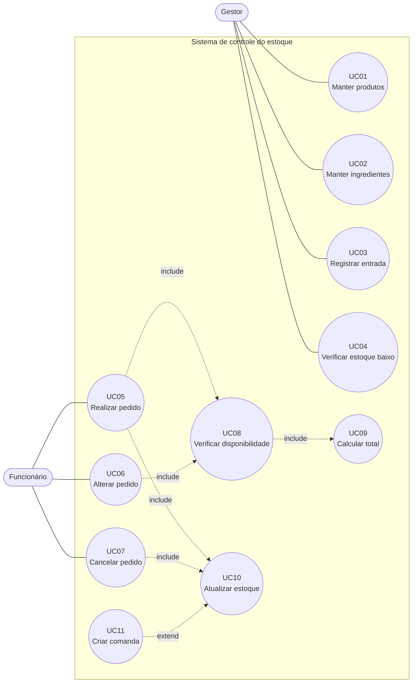
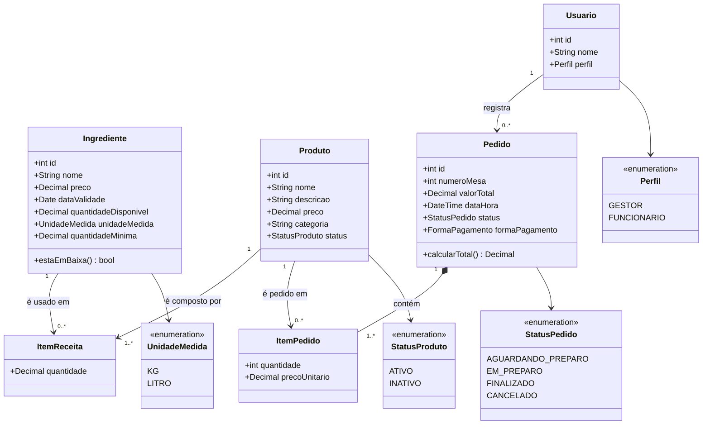
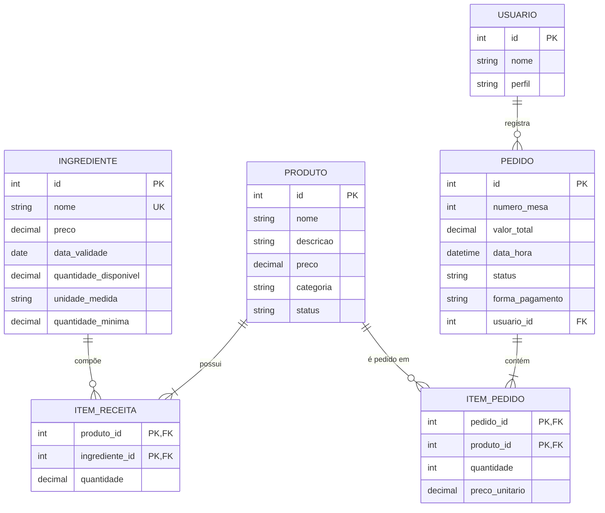
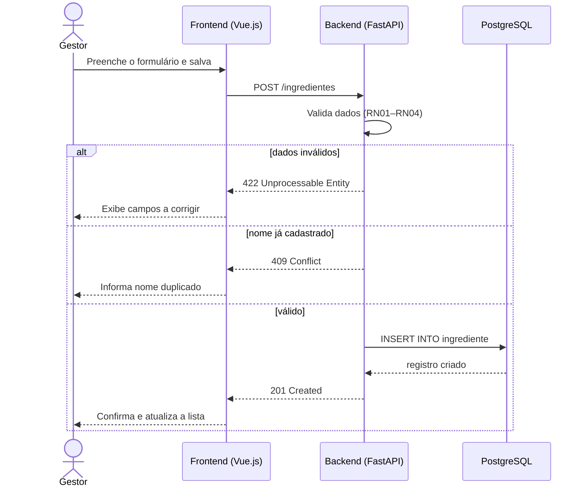

# Documento de Modelos — Big Hangus Estoque

| Versão | Data       | Descrição                   | Autores                                                                                                               |
|--------|------------|-----------------------------|-----------------------------------------------------------------------------------------------------------------------|
| 1.0    | 16/11/2026 | Versão inicial do documento | Andressa Carla da Silva, Elisson da Silva Tavares, Gabriel Victor de Souza Fernandes, Vanesca Héllen dos Santos Silva |

Este documento reúne os modelos do sistema: casos de uso, modelo de classes, modelo entidade-relacionamento e modelo relacional. Os diagramas usam Mermaid e são renderizados diretamente no GitHub. Os requisitos estão descritos no [Documento de Visão](doc-visao.md).

> **Escopo da implementação:** os modelos cobrem o sistema completo, mas o CRUD implementado nesta etapa é o de **Ingredientes (estoque)**, ligado ao caso de uso **UC02 — Manter ingredientes**.

## 1. Modelo de casos de uso

### 1.1 Atores

| Ator        | Descrição                                                              |
|-------------|------------------------------------------------------------------------|
| Gestor      | Usuário administrador: produtos, ingredientes, entradas e alertas      |
| Funcionário | Realiza, altera e cancela pedidos                                      |

### 1.2 Diagrama de casos de uso



### 1.3 Lista de casos de uso

| ID   | Caso de uso                   | Ator        | Requisito | Implementado agora |
|------|-------------------------------|-------------|-----------|--------------------|
| UC01 | Manter produtos               | Gestor      | RF01      | Não                |
| UC02 | **Manter ingredientes**       | Gestor      | RF02      | **Sim**            |
| UC03 | Registrar entrada de estoque  | Gestor      | RF02      | Não                |
| UC04 | Verificar estoque baixo       | Gestor      | RF06      | Não                |
| UC05 | Realizar pedido               | Funcionário | RF03, RF05 | Não               |
| UC06 | Alterar pedido                | Funcionário | RF03      | Não                |
| UC07 | Cancelar pedido               | Funcionário | RF03, RF05 | Não               |
| UC08 | Verificar disponibilidade     | Sistema     | RF05      | Não                |
| UC09 | Calcular total                | Sistema     | RF03      | Não                |
| UC10 | Atualizar estoque             | Sistema     | RF05      | Não                |
| UC11 | Criar comanda                 | Sistema     | RF04      | Não                |

### 1.4 Especificação do caso de uso UC02 — Manter ingredientes

| Item                      | Descrição                                                                                                  |
|---------------------------|------------------------------------------------------------------------------------------------------------|
| Nome                      | Manter ingredientes                                                                                        |
| Ator                      | Gestor                                                                                                     |
| Resumo                    | Gestão (inclusão, alteração, exclusão e consulta) dos ingredientes do estoque                              |
| Pré-condições             | Gestor com acesso ao sistema (perfil administrador, conforme RNF05, quando a autenticação for implementada) |
| Pós-condições             | As informações do ingrediente são armazenadas, atualizadas ou removidas no sistema                         |
| Requisitos não funcionais | RNF01 (desempenho), RNF05 (controle administrativo)                                                        |

**Regras de negócio**

| ID   | Regra                                                                                  |
|------|----------------------------------------------------------------------------------------|
| RN01 | O nome do ingrediente é obrigatório e único                                            |
| RN02 | A quantidade disponível e a quantidade mínima não podem ser negativas                  |
| RN03 | O preço deve ser maior ou igual a zero                                                 |
| RN04 | A unidade de medida deve ser `kg` ou `litros`                                          |
| RN05 | Um ingrediente é considerado em baixa quando a quantidade disponível está abaixo da mínima |

**Cenário principal — Inclusão**

1. O gestor informa nome, preço, data de validade, quantidade disponível, unidade de medida e quantidade mínima.
2. O sistema valida os dados.
3. O sistema salva o ingrediente e confirma a inclusão.

**Cenário principal — Consulta**

1. O gestor acessa a lista de ingredientes e, se quiser, filtra por nome.
2. O sistema exibe os ingredientes, destacando os que estão em baixa.
3. O gestor seleciona um ingrediente e o sistema exibe seus dados completos.

**Cenário principal — Alteração**

1. O gestor seleciona o ingrediente.
2. O gestor informa os novos dados e confirma.
3. O sistema valida e armazena as novas informações.

**Cenário principal — Exclusão**

1. O gestor seleciona o ingrediente e escolhe remover.
2. O sistema pede confirmação.
3. O gestor confirma e o sistema remove o registro.

**Cenários alternativos**

| ID  | Situação                                  | Resposta do sistema                                                      |
|-----|-------------------------------------------|--------------------------------------------------------------------------|
| A1  | Dado inválido ou obrigatório ausente      | Exibe mensagem indicando qual dado deve ser corrigido                    |
| A2  | Nome já cadastrado                        | Informa que já existe ingrediente com esse nome                          |
| A3  | Ingrediente não existe (consulta, alteração ou exclusão) | Exibe mensagem de item inexistente e volta à tela anterior |
| A4  | Gestor cancela a confirmação da exclusão  | Mantém o registro e volta à lista                                        |

## 2. Modelo de classes



> Estados do pedido: a alteração e o cancelamento só são permitidos em `AGUARDANDO_PREPARO`, conforme a documentação do caso de uso de pedidos do projeto de OSM.

## 3. Modelo entidade-relacionamento



## 4. Modelo relacional

```
INGREDIENTE (id PK, nome UK, preco, data_validade, quantidade_disponivel,
             unidade_medida, quantidade_minima)

PRODUTO (id PK, nome, descricao, preco, categoria, status)

ITEM_RECEITA (produto_id PK/FK -> PRODUTO.id,
              ingrediente_id PK/FK -> INGREDIENTE.id,
              quantidade)

USUARIO (id PK, nome, perfil)

PEDIDO (id PK, numero_mesa, valor_total, data_hora, status,
        forma_pagamento, usuario_id FK -> USUARIO.id)

ITEM_PEDIDO (pedido_id PK/FK -> PEDIDO.id,
             produto_id PK/FK -> PRODUTO.id,
             quantidade, preco_unitario)
```

### 4.1 Restrições de integridade

| Tabela       | Restrição                                                                        |
|--------------|----------------------------------------------------------------------------------|
| INGREDIENTE  | `nome` único e não nulo; `preco >= 0`; `quantidade_disponivel >= 0`; `quantidade_minima >= 0`; `unidade_medida IN ('kg', 'litros')` |
| PRODUTO      | `preco >= 0`; `status IN ('ativo', 'inativo')`                                   |
| ITEM_RECEITA | `quantidade > 0`; exclusão de produto remove sua receita (`ON DELETE CASCADE`)   |
| ITEM_RECEITA | exclusão de ingrediente é bloqueada se estiver em alguma receita (`ON DELETE RESTRICT`) |
| PEDIDO       | `status IN ('aguardando_preparo', 'em_preparo', 'finalizado', 'cancelado')`      |
| ITEM_PEDIDO  | `quantidade > 0`                                                                 |

### 4.2 Script SQL (apenas o necessário para o CRUD implementado)

```sql
CREATE TABLE ingrediente (
    id                    SERIAL PRIMARY KEY,
    nome                  VARCHAR(100)  NOT NULL UNIQUE,
    preco                 NUMERIC(10,2) NOT NULL CHECK (preco >= 0),
    data_validade         DATE,
    quantidade_disponivel NUMERIC(10,3) NOT NULL CHECK (quantidade_disponivel >= 0),
    unidade_medida        VARCHAR(10)   NOT NULL CHECK (unidade_medida IN ('kg', 'litros')),
    quantidade_minima     NUMERIC(10,3) NOT NULL CHECK (quantidade_minima >= 0)
);
```

## 5. Modelo da API do CRUD de ingredientes

| Operação  | Método   | Rota                    | Corpo         | Resposta de sucesso            | Erros                        |
|-----------|----------|-------------------------|---------------|--------------------------------|------------------------------|
| Incluir   | `POST`   | `/ingredientes`         | Ingrediente   | `201 Created` + ingrediente    | `409` nome duplicado, `422` dado inválido |
| Listar    | `GET`    | `/ingredientes`         | —             | `200 OK` + lista (filtro `nome`, `em_baixa`) | —              |
| Consultar | `GET`    | `/ingredientes/{id}`    | —             | `200 OK` + ingrediente         | `404` não encontrado         |
| Alterar   | `PUT`    | `/ingredientes/{id}`    | Ingrediente   | `200 OK` + ingrediente         | `404`, `409`, `422`          |
| Excluir   | `DELETE` | `/ingredientes/{id}`    | —             | `204 No Content`               | `404`, `409` se em uso       |

**Exemplo de corpo (JSON):**

```json
{
  "nome": "Queijo mussarela",
  "preco": 42.90,
  "data_validade": "2026-12-20",
  "quantidade_disponivel": 8.5,
  "unidade_medida": "kg",
  "quantidade_minima": 2
}
```

## 6. Diagrama de sequência — incluir ingrediente


