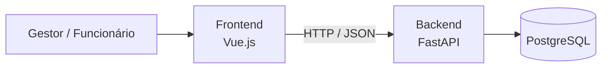

# Documento de Visão — Big Hangus Estoque

| Versão | Data       | Descrição                    | Autores                                                                                           |
|--------|------------|------------------------------|---------------------------------------------------------------------------------------------------|
| 1.0    | 16/11/2026 | Versão inicial do documento  | Andressa Carla da Silva, Elisson da Silva Tavares, Gabriel Victor de Souza Fernandes, Vanesca Héllen dos Santos Silva |

## 1. Introdução

### 1.1 Finalidade

Este documento descreve a visão do **Big Hangus Estoque**, um sistema de controle de estoque para a lanchonete Big Hangus. Ele registra as necessidades dos envolvidos, as capacidades do produto e as restrições do projeto, servindo de referência para a equipe de desenvolvimento.

### 1.2 Escopo

O documento cobre o sistema completo definido no projeto prático da disciplina de Organização, Sistemas e Métodos (OSM): cadastro de produtos e ingredientes, entradas de estoque, pedidos, comandas, atualização automática do estoque e alertas de baixa quantidade.

> **Escopo da entrega atual:** nesta etapa da disciplina será implementado **um CRUD**, o de **Ingredientes (estoque)**, descrito em [RF02]. As demais funcionalidades permanecem documentadas como visão de produto, mas não serão implementadas agora.

### 1.3 Definições, acrônimos e abreviações

| Termo       | Definição                                                                                  |
|-------------|--------------------------------------------------------------------------------------------|
| Gestor      | Usuário administrador, responsável por produtos, ingredientes e entradas de estoque        |
| Funcionário | Usuário que registra, altera e cancela pedidos (chamado de "caixa" em partes do documento de OSM) |
| Ingrediente | Item armazenado no estoque e usado na composição dos produtos                              |
| Produto     | Item do cardápio vendido ao cliente, composto por ingredientes                             |
| Comanda     | Impressão do pedido, com via do cliente e via do balcão                                    |
| CRUD        | Create, Read, Update, Delete                                                               |
| RF / RNF    | Requisito Funcional / Requisito Não Funcional                                              |

### 1.4 Referências

- Projeto Prático — Big Hangus Hamburgueria (OSM, UFRN/CERES, 2026).
- Modelos de documentação da disciplina de Engenharia de Software: `doc-visao.md` e `doc-modelos.md`.
- [Documento de Modelos](doc-modelos.md) deste repositório.

## 2. Posicionamento

### 2.1 Oportunidade de negócio

Lanchonetes de pequeno porte perdem vendas e dinheiro quando um pedido é aceito sem que haja ingredientes suficientes para prepará-lo. Um controle de estoque confiável, integrado ao fluxo de pedidos, reduz desperdício, evita frustração do cliente e dá ao gestor visibilidade para repor itens a tempo.

### 2.2 Sentença do problema

| Item                | Descrição                                                                                                                                  |
|---------------------|--------------------------------------------------------------------------------------------------------------------------------------------|
| O problema          | O controle de estoque atual é ineficiente e não permite perceber a falta de um ingrediente antes da preparação do pedido                    |
| Afeta               | Gestor e funcionários da lanchonete, e os clientes atendidos                                                                               |
| O impacto é         | Pedidos que não podem ser concluídos, clientes frustrados, retrabalho e possíveis prejuízos financeiros                                    |
| Uma solução bem-sucedida | Monitora o estoque com atualização automática a cada pedido, valida a disponibilidade antes de confirmar vendas e alerta sobre ingredientes em baixa |

### 2.3 Sentença de posição do produto

| Item                  | Descrição                                                                                              |
|-----------------------|--------------------------------------------------------------------------------------------------------|
| Para                  | Gestores e funcionários da lanchonete Big Hangus                                                       |
| Que                   | Precisam saber, em tempo real, quais ingredientes estão disponíveis                                    |
| O Big Hangus Estoque  | É um sistema web de controle de estoque                                                                |
| Que                   | Cadastra ingredientes e produtos, atualiza o estoque automaticamente e emite alertas de baixa          |
| Diferente de          | O sistema atual da lanchonete, cujo controle de estoque não é eficiente                                |
| Nosso produto         | Impede a venda de itens sem ingredientes suficientes e antecipa a reposição                            |

## 3. Descrições das partes interessadas e dos usuários

### 3.1 Resumo das partes interessadas

| Nome                     | Descrição                                       | Responsabilidades                                                       |
|--------------------------|-------------------------------------------------|-------------------------------------------------------------------------|
| Proprietário/Gestão Big Hangus | Dono da lanchonete, interessado no resultado | Validar requisitos e priorizar funcionalidades                          |
| Equipe de desenvolvimento | Estudantes de Sistemas de Informação (UFRN/CERES) | Projetar, implementar, testar e documentar o sistema                |
| Docente da disciplina    | Avaliador do projeto                            | Acompanhar sprints e avaliar entregas                                   |

### 3.2 Resumo dos usuários

| Nome        | Descrição                                                       | Responsabilidades                                                                 | Parte interessada |
|-------------|-----------------------------------------------------------------|-----------------------------------------------------------------------------------|-------------------|
| Gestor      | Administrador do sistema                                        | Manter produtos e ingredientes, registrar entradas, verificar estoque baixo       | Gestão Big Hangus |
| Funcionário | Atendente/caixa que registra pedidos                            | Realizar, alterar e cancelar pedidos; imprimir comanda                            | Gestão Big Hangus |

### 3.3 Ambiente do usuário

O sistema será usado nos computadores já existentes na lanchonete, via navegador, durante todo o horário de funcionamento. Não deve exigir equipamentos de alto desempenho [RNF04].

### 3.4 Perfis das partes interessadas

#### Gestor

| Item                | Descrição                                                                            |
|---------------------|--------------------------------------------------------------------------------------|
| Representante       | Proprietário/gestor da lanchonete                                                    |
| Tipo                | Usuário administrador                                                                |
| Responsabilidades   | Cadastro e atualização de produtos e ingredientes; registro de entradas de estoque   |
| Critério de sucesso | Nenhum pedido é perdido por falta de ingrediente não detectada                       |
| Envolvimento        | Validação dos requisitos e das entregas                                              |

#### Funcionário

| Item                | Descrição                                                                    |
|---------------------|------------------------------------------------------------------------------|
| Representante       | Atendente/caixa                                                              |
| Tipo                | Usuário operacional                                                          |
| Responsabilidades   | Realizar, alterar e cancelar pedidos                                         |
| Critério de sucesso | Registrar pedidos rapidamente, sabendo de antemão se há ingredientes         |
| Envolvimento        | Usuário final                                                                |

### 3.5 Necessidades principais das partes interessadas e dos usuários

| Necessidade                                         | Prioridade | Solução atual                         | Solução proposta                                            |
|-----------------------------------------------------|------------|---------------------------------------|-------------------------------------------------------------|
| Saber a quantidade disponível de cada ingrediente   | Alta       | Controle ineficiente no sistema atual | Cadastro e consulta de estoque de ingredientes [RF02]       |
| Não vender o que não pode ser preparado             | Alta       | Percebido só na hora do preparo       | Verificação de disponibilidade antes de confirmar [RF05]    |
| Ser avisado antes de o ingrediente acabar           | Alta       | Inexistente                           | Alerta de baixa quantidade [RF06]                           |
| Manter o cardápio atualizado                        | Média      | Sistema atual                         | Cadastro de produtos com ingredientes [RF01]                |
| Imprimir a comanda do pedido                        | Média      | Sistema atual                         | Impressão de comanda em duas vias [RF04]                    |

## 4. Visão geral do produto

### 4.1 Perspectiva do produto

O Big Hangus Estoque é uma aplicação web composta por dois componentes independentes, cada um em seu repositório:

- **Backend** — API REST em Python com FastAPI, persistência em PostgreSQL, executado com Docker.
- **Frontend** — interface web em Vue.js que consome a API.

### 4.2 Resumo das capacidades

| Benefício para o cliente                              | Recurso que o suporta                                  |
|-------------------------------------------------------|--------------------------------------------------------|
| Visão confiável do que há no estoque                  | Cadastro e consulta de ingredientes                    |
| Menos pedidos frustrados                              | Verificação de disponibilidade antes da venda          |
| Reposição no tempo certo                              | Alerta e listagem de ingredientes em baixa             |
| Estoque sempre atual                                  | Baixa automática por pedido e devolução por cancelamento |
| Cardápio organizado                                   | Cadastro de produtos e suas receitas                   |

### 4.3 Suposições e dependências

- A lanchonete possui computadores com navegador moderno e acesso à rede local ou internet.
- A ficha técnica (ingredientes e quantidades de cada produto) será informada pelo gestor.
- A integração com impressoras ([RNF06]) depende dos modelos usados pela lanchonete e está fora da entrega atual.

## 5. Recursos do produto

| ID   | Recurso                          | Descrição resumida                                                                                  | Situação nesta entrega |
|------|----------------------------------|-----------------------------------------------------------------------------------------------------|------------------------|
| RF01 | Manter produtos                  | Incluir, alterar, excluir e consultar produtos do cardápio, com ingredientes e quantidades          | Fora do escopo atual   |
| RF02 | **Manter estoque de ingredientes** | Incluir, alterar, excluir e consultar ingredientes: nome, preço, validade, quantidade, unidade, mínimo | **Implementado (CRUD)** |
| RF03 | Manter pedidos                   | Criar, editar e cancelar pedidos                                                                    | Fora do escopo atual   |
| RF04 | Imprimir comanda                 | Comanda em via do cliente e via do balcão, com tempo de espera estimado                             | Fora do escopo atual   |
| RF05 | Controle de estoque              | Atualização automática e validação de disponibilidade antes de confirmar o pedido                   | Fora do escopo atual   |
| RF06 | Alerta de baixa de ingredientes  | Alerta e listagem de ingredientes abaixo do mínimo                                                  | Fora do escopo atual   |

## 6. Restrições

- O projeto é acadêmico, com duas sprints para a entrega.
- Tecnologias definidas: **Python, FastAPI, Docker e PostgreSQL** (backend) e **Vue.js** (frontend).
- Dois repositórios separados: backend e frontend.
- A documentação (`doc-visao.md` e `doc-modelos.md`) fica no diretório `docs` do repositório de backend.
- Apenas um CRUD será implementado nesta etapa.

## 7. Requisitos de qualidade

| ID     | Requisito                        | Descrição                                                                                          |
|--------|----------------------------------|----------------------------------------------------------------------------------------------------|
| RNF01  | Desempenho                       | Operações concluídas em até 4 segundos                                                             |
| RNF02  | Disponibilidade                  | Sistema disponível durante todo o horário de funcionamento                                         |
| RNF03  | Atualização automática do estoque | Baixa dos ingredientes ao finalizar pedido e reposição em caso de cancelamento                    |
| RNF04  | Compatibilidade                  | Funcionar nos computadores da lanchonete, sem hardware de alto desempenho                          |
| RNF05  | Controle administrativo          | Somente o gestor autenticado como administrador cadastra e atualiza produtos e estoque             |
| RNF06  | Gestão de impressão              | Integração com as impressoras para envio automático das comandas                                   |

> **Observação:** o RNF05 (autenticação do gestor) e os RNF03 e RNF06 dependem de funcionalidades fora do CRUD da entrega atual. A autenticação está registrada como item opcional no backlog.

## 8. Precedência e prioridade

| Prioridade | Recursos                                                      |
|------------|---------------------------------------------------------------|
| 1 (alta)   | RF02 — Manter estoque de ingredientes (base de todo o sistema) |
| 2          | RF01 — Manter produtos; RF05 — Controle de estoque            |
| 3          | RF03 — Manter pedidos; RF06 — Alerta de baixa                 |
| 4          | RF04 — Imprimir comanda                                       |

O CRUD de ingredientes vem primeiro porque produtos, pedidos, controle de estoque e alertas dependem dos dados de estoque.

## 9. Outros requisitos

- **Dados:** a quantidade e a unidade de medida devem ser coerentes (kg ou litros); quantidades não podem ser negativas.
- **Segurança:** acesso administrativo restrito ao gestor [RNF05] (previsto para evolução).
- **Implantação:** o backend e o banco de dados devem subir com `docker compose`.
